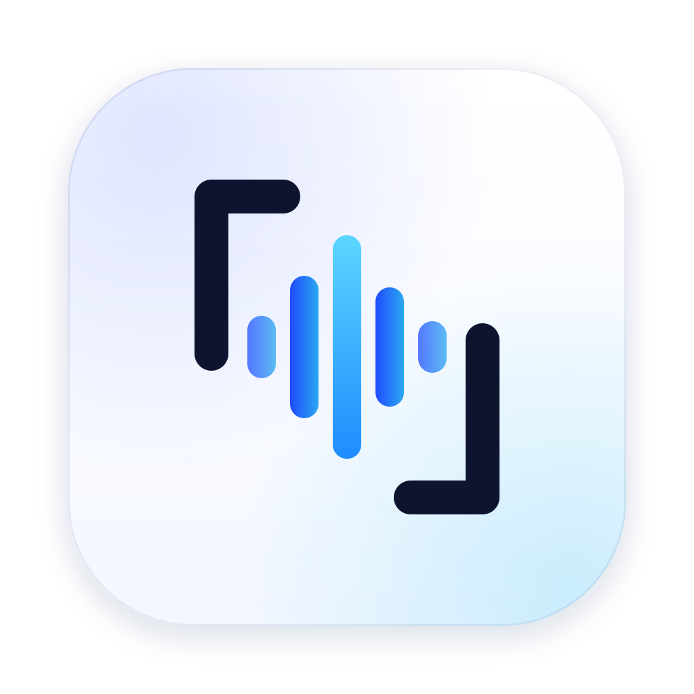
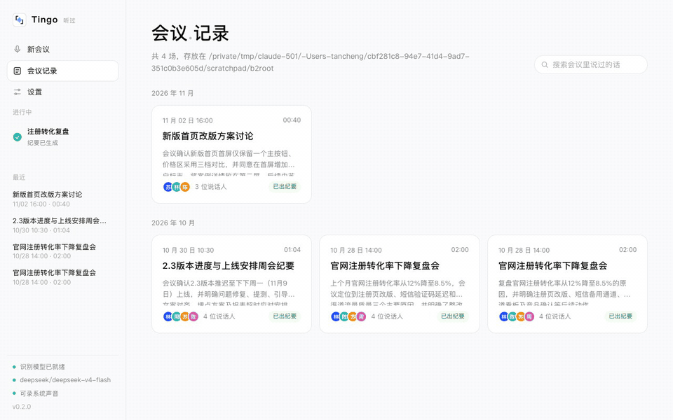
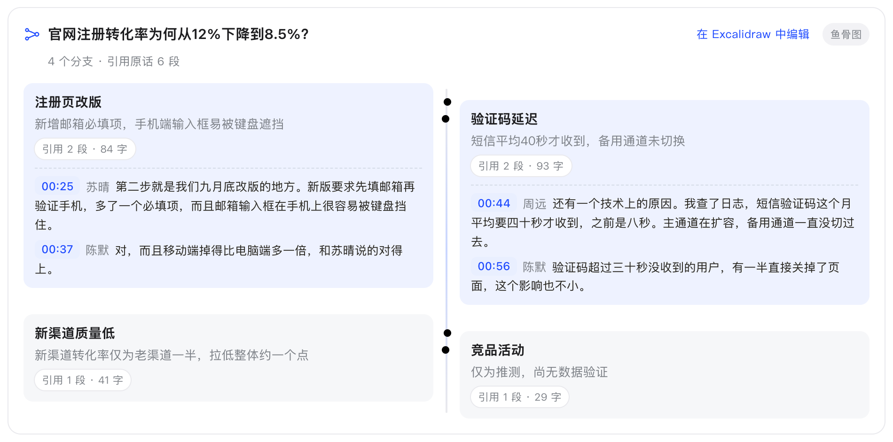
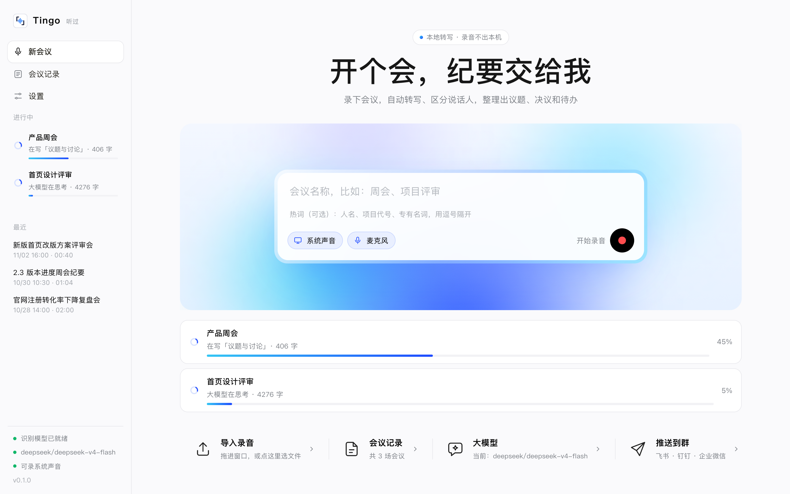
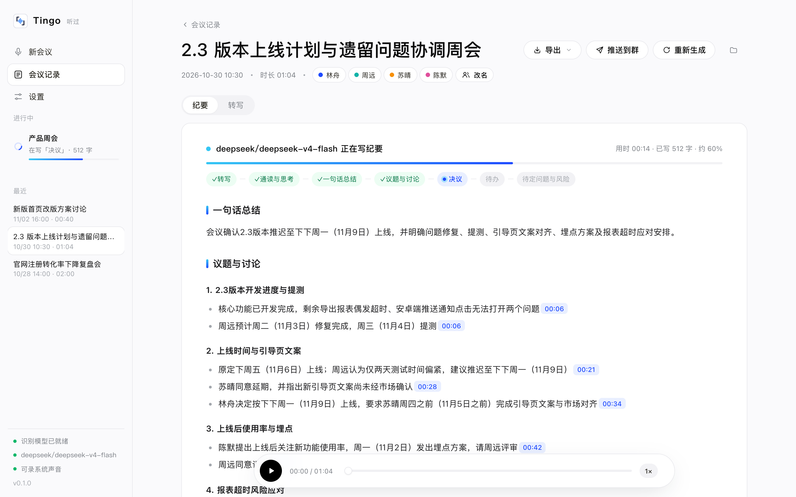
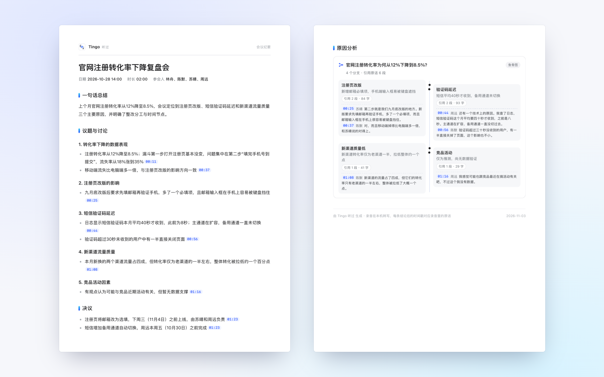

<p align="center"></p>

<h1 align="center">Tingo</h1>

<p align="center"><b>Every meeting, heard.</b><br>Local-first meeting minutes for Chinese — and every conclusion links back to what was actually said.</p>

<p align="center">
  <a href="https://github.com/tancheng33/tingo/releases/latest"></a>
  
  
  <a href="README.md"></a>
</p>

<p align="center"></p>

*Tingo* comes from 听 (*tīng*, "to listen"); its Chinese name 听过 means "heard it".

Tingo records Tencent Meeting / Feishu / Zoom audio plus your mic, transcribes it **on your machine**, tells speakers apart, and has the LLM of your choice write structured minutes: topics, decisions, action items with owners and due dates, risks — and, when the meeting discussed *why* something happened, a **fishbone diagram whose every branch is bound to the original quotes**.

- **Audio never leaves your Mac.** Speech recognition and speaker diarization run locally. Minutes can be written by DeepSeek, Qwen or any OpenAI-compatible API — or a local Ollama model, fully offline.
- **Built for Chinese.** Uses Alibaba DAMO's FunASR models, which handle Chinese punctuation, numbers and names far better than English-first stacks. Relative dates ("next Wednesday", "end of month") are resolved against the meeting date.
- **Every claim has a source.** Each line of the minutes carries a timestamp that jumps to that second of the recording. The fishbone diagram counts how much original speech backs each branch and flags the ones with **no evidence** — so hand-waving is visible at a glance.
- **English and Chinese.** The app, the minutes and every export work in both languages. English meetings are recognized with SenseVoice, and a Chinese meeting can get English minutes (and vice versa).
- **12 MB desktop app.** Tauri + Rust, no Python or ffmpeg needed. A live recording is fully transcribed seconds after you hit stop; a 76-minute file imports in about 3.5 minutes on an M1 Pro.

Looking for a **free, open-source, local alternative to Otter.ai, Granola, Fireflies.ai or Fathom** — an AI meeting note taker that never uploads your audio? That's what Tingo is for.

> The meetings, names and numbers in the screenshots are fictional demo data.

## Highlights

**Evidence-bound fishbone diagrams.** When a meeting analyzes causes, Tingo draws a fishbone. Expand a branch to see who said what and when; click a timestamp to listen. Branches whose cited timestamps can't be found in the transcript are marked red ("no evidence"), thin ones amber. Export to [Excalidraw](https://excalidraw.com) with one click.

<p align="center"></p>

**Never wait.** Stop recording and start the next meeting right away — transcription and minutes run in the background, with per-task progress in the sidebar. Open a meeting to watch the minutes being written section by section (including "thinking" progress for reasoning models).

<p align="center"> </p>

**Search everything that was said.** Search across all transcripts and jump to the exact second. A names & terms table at the end of the minutes records the correct spelling and misheard variants, so searching finds those too — and you can add them all to your hotwords in one click.

**Less busywork.** Let AI guess who's who from how people address each other (each guess comes with evidence). Recording stops by itself when the meeting app quits or after 10 minutes of silence, and the silent tail is trimmed.

**Export & share.** A4 PDF, editable Word, SRT subtitles (fishbone quotes expanded on paper), Obsidian notes with properties and an embedded Excalidraw drawing (optionally automatic), Feishu / DingTalk / WeCom group bots, or plain Markdown.

<p align="center"></p>

**Swappable ASR models.** Paraformer-large (default, fast and accurate for Chinese), SenseVoice (mixed Chinese / English / Japanese / Korean / Cantonese) or Fun-ASR-Nano (most accurate, applies your hotwords during recognition) — downloaded and switched in Settings, all running locally.

## Install

**Desktop app:** download `Tingo_x.y.z_aarch64.dmg` from [Releases](https://github.com/tancheng33/tingo/releases/latest) (Apple Silicon, macOS 13+; recording system audio needs macOS 15+). On first launch it downloads ~330 MB of models, then works offline.

The app is not notarized yet. On first launch, right-click Tingo in Applications → **Open**, or run:

```bash
xattr -dr com.apple.quarantine /Applications/Tingo.app
```

**Command line** (Python + FunASR; needs Python 3.11+ and ffmpeg):

```bash
uv tool install git+https://github.com/tancheng33/tingo
tingo record -t standup        # record system audio + mic, Ctrl+C to stop, minutes follow
tingo run meeting.mp4          # process an existing recording
tingo ui                       # open the GUI
```

## Privacy

Audio and transcripts stay on your machine. When generating minutes, the **transcript text** is sent to the LLM endpoint you configure — use a local Ollama model to keep that offline too. The built-in server listens on 127.0.0.1 only. No analytics, no telemetry.

## How it works

ScreenCaptureKit records system audio and mic → audio is chunked at pauses while recording → VAD → ASR (Paraformer / SenseVoice / Fun-ASR-Nano via [sherpa-onnx](https://github.com/k2-fsa/sherpa-onnx)) → punctuation → CAM++ speaker embeddings → spectral clustering → LLM minutes (map-reduce for long meetings, dates resolved, glossary to fix homophones) → every fishbone citation is checked against the transcript. Engine comparison notes: [`spike/sherpa/RESULTS.md`](spike/sherpa/RESULTS.md) (in Chinese).

## FAQ

**How do I record and transcribe a Zoom / Teams / Google Meet call on Mac?** Hit record in Tingo. It captures system audio (the other side) and your microphone at the same time — no BlackHole or virtual audio device needed. You can also drop in recordings exported by the meeting app.

**Is my audio uploaded?** No. Transcription and speaker separation run on your Mac. Only the transcript text goes to the LLM you configure — use a local Ollama model and nothing leaves the machine.

**Which LLMs are supported?** Any OpenAI-compatible API (OpenAI, Gemini, DeepSeek, Qwen, Ollama, …) and the Anthropic (Claude) API.

**Does it work for English meetings?** Yes. Switch the speech model to SenseVoice and the app and minutes to English in Settings.

## Development

```bash
git clone https://github.com/tancheng33/tingo && cd tingo
uv sync && uv run pytest -m "not slow"     # Python backend / CLI
cd app && pnpm install && pnpm tauri dev   # desktop app (Tauri + Rust)
cd engine && cargo test                    # Rust core
```

Issues and PRs are welcome. Licensed under [MIT](LICENSE).
